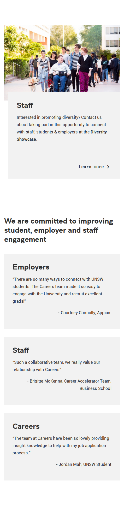
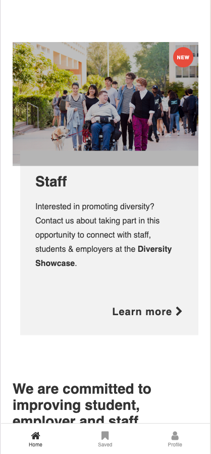

##  Task 1: Use CSS to create a fixed size mobile screen with some overlapping

Build a page that looks identical to `page.png`. The window width you should work with is 475 x 1953 pixels. You are only allowed to use HTML and CSS for this task. No external libraries are permitted.

Please build your page in `index.html`. You are welcome to create as many CSS files that you need.

### Assets

* Your fonts do not need to match exactly. You may use font-family `Helvetica` or `sans-serif` for the page.
* Assets can be found in `assets` which you can use for your solution.

### Analysing the pages

Two things will want to seek external help for are (that you can't determine just by "looking" at it):
1) Determining the particular colour (RGB or HEX) of various pixels (we recommend the use of [the Firefox eye dropper](https://developer.mozilla.org/en-US/docs/Tools/Eyedropper), though other alternatives may be appropriate for you)
2) Determining the size of particular elements (we recommend the use of [photopea](https://www.photopea.com/)). An example of it's usage is below:

### How closely to match images

Your page has to generally look the same, but doesn't have to be pixel perfect. We won't use a magnifying glass, though we will expect you to get the big things right. If you feel uncertain, please post in the forum.

---

## Task 2: Layered overlays and fixed mobile navigation

Build a mobile layout that matches `page_task2.png`. The viewport size to work with is 475 × 896 pixels. The top and bottom navigation bars should remain fixed, while the middle content area scrolls independently.

Extend your `index.html` to add the following elements using CSS absolute/fixed positioning and `z-index` stacking.

### Part A — Image overlay and badge

Modify the leading article image area so it has multiple layers stacked on top of each other.

### Part B — Fixed mobile bottom navigation bar

Add a `<nav>` element at the bottom of `<body>` that acts as a mobile tab bar.
