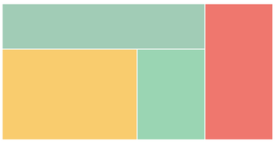

# Using CSS to replicate a simple flex-based layout (1)
## Task1

In `flex_task1.html` use `div` tags with `flex` properties to create a page that vaguely resembles this image:

Challenge: How easily can you rotate the entire box by 90 degrees?

## Task2

In `flex_task2.html` use `div` tags with `flex` properties to create a page that vaguely resembles the layout below.

Challenge: Can you refactor all inline styles to use a `<style>` block with CSS classes?

